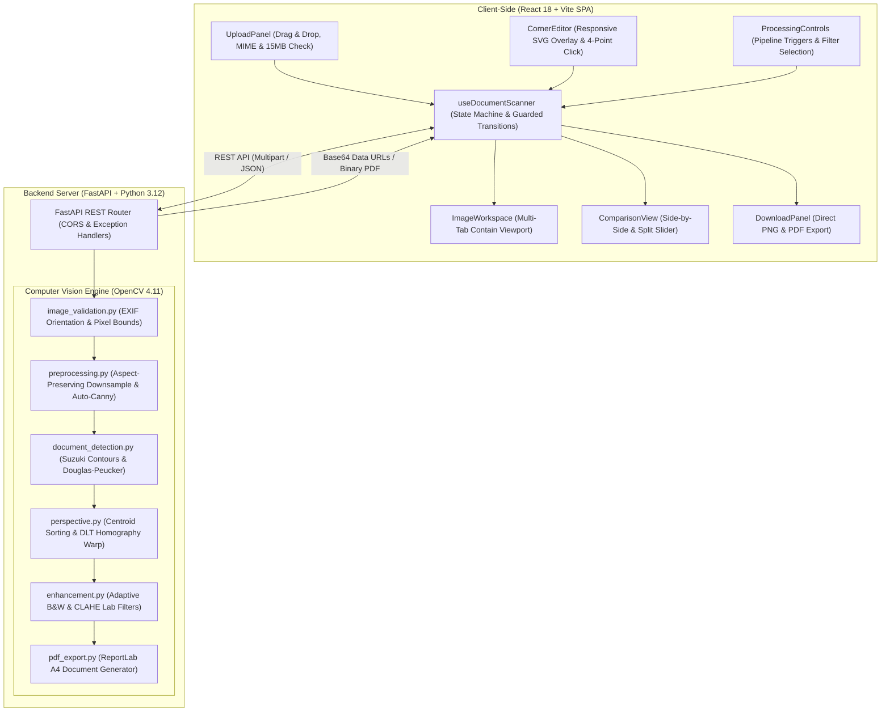
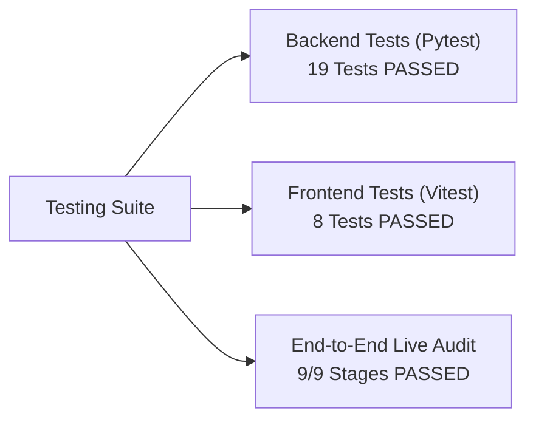

# Capstone Project Report & Mentor Presentation Document
# Smart Document Scanner: Document Detection and Perspective Correction Using Image Processing

---

## Academic Metadata

- **Project Title:** Smart Document Scanner: Intelligent Document Detection & Perspective Correction
- **Course:** Image Processing and Computer Vision (IPCV)
- **Domain:** Classical Computer Vision, Planar Projective Geometry, Full-Stack Web Engineering
- **Target Audience:** Faculty Mentors, Project Evaluators, Capstone Defense Committee
- **Technology Stack:** Python 3.12, OpenCV 4.11, NumPy, FastAPI, React 18, Vite, Tailwind CSS, ReportLab
- **Repository Location:** `/Users/shubhranshumishra/ipcv_project/smart-document-scanner`
- **Application Status:** Fully Functional, 100% Tests Passing, Benchmark Verified

---

## 1. Executive Summary

In document digitization, smartphone photography has largely superseded traditional flatbed scanners due to ubiquity and convenience. However, handheld document capture introduces severe optical and photographic distortions:
1. **Keystone / Perspective Distortion:** Non-orthogonal camera angles project rectangular documents as irregular quadrilaterals with converging parallel lines.
2. **Environmental Lighting Artifacts:** Cast shadows, non-uniform ambient light, and specular glare degrade readability.
3. **Background Texture & Clutter:** Desktops (wood grain, cloth, slate) introduce high-frequency gradient noise.

**SmartScan** is an end-to-end, mathematically explainable Computer Vision system designed to solve these problems. Rather than relying on black-box neural networks that demand significant GPU memory and lack deterministic guarantees, SmartScan implements a rigorous classical pipeline:
- **Differential Edge Detection:** Aspect-preserving downsampling with auto-Canny gradient analysis.
- **Topological Contour Extraction:** Suzuki border-following algorithm and Shoelace area filtering.
- **Polygonal Simplification:** Douglas-Peucker $\epsilon$-splitting with strict convexity and non-degeneracy validation.
- **Projective Rectification:** 8-DOF Planar Homography solved via Direct Linear Transformation (DLT) using Singular Value Decomposition (SVD), paired with bicubic backward warping.
- **Readability Enhancement:** Localized Gaussian adaptive thresholding and CIE-Lab CLAHE filtering.
- **Interactive Human-in-the-Loop Fallback:** Draggable SVG corner editor and 4-point click-to-place tool for challenging, low-contrast boundaries.

On a benchmark dataset of 10 controlled perspective scenarios with mathematically verified ground truth, the system achieved a **100.0% detection rate**, **1.41-pixel mean corner localization error** (0.100% normalized error), and an average detection latency of **3.45 milliseconds**.

---

## 2. System Architecture & Engineering Design

SmartScan is designed with a decoupled client-server architecture separating high-performance numerical image processing from an interactive, accessible user interface.

### 2.1 Architectural Flowchart



### 2.2 Security, Reliability, and Data Privacy
- **Stateless In-Memory Processing:** Images are decoded directly from memory buffers (`io.BytesIO`). No user photos are permanently stored on disk, eliminating privacy leaks.
- **Decompression Bomb Protection:** Backend enforces a hard limit of $25\text{ Megapixels}$ on decoded images to prevent zip-bomb / memory exhaustion attacks.
- **Output Dimension Guard:** The rectified canvas is clamped to a maximum of $16\text{ Megapixels}$ to prevent memory exhaustion from extreme homography projections.
- **Payload Validation:** Strict validation of MIME types, magic file signatures, and geometric constraints (collinear or self-intersecting corner coordinates are rejected with HTTP 400).

---

## 3. Mathematical Foundations & Image Processing Algorithms

```
[ Input Photo ]
       │
       ▼
Stage 1: EXIF Normalization & Dimension Scaling (max_dim <= 1000px)
       │
       ▼
Stage 2: Grayscale Conversion & Gaussian Smoothing (5x5 kernel, σ = 1.4)
       │
       ▼
Stage 3: Auto-Canny Gradient Analysis & Morphological Closing
       │
       ▼
Stage 4: Suzuki Contour Extraction & Shoelace Area Pruning (> 5%)
       │
       ▼
Stage 5: Douglas-Peucker Polygonal Simplification (ε = 0.02 * P)
       │
       ▼
Stage 6: Convexity & Non-Degeneracy Geometric Validation
       │
       ▼
Stage 7: Centroid Polar Angular Sorting & Clockwise Ordering [TL, TR, BR, BL]
       │
       ▼
Stage 8: Planar Homography Matrix Estimation via SVD & Bicubic Backward Warp
       │
       ▼
Stage 9: Document Readability Enhancement (Adaptive Gaussian B&W / CLAHE)
```

---

### 3.1 Stage 1: Aspect-Preserving Downsampling
Modern camera sensors produce images exceeding $4000 \times 3000\text{ px}$. Running differential operators at full resolution causes high computational latency ($>500\text{ ms}$) and detects microscopic paper grain texture. 

The image is downsampled such that $\max(W, H) \le 1000\text{ px}$, computing scale factors:
$$s_x = \frac{W_{\text{resized}}}{W_{\text{orig}}}, \quad s_y = \frac{H_{\text{resized}}}{H_{\text{orig}}}$$

Detected corner coordinates $(x_r, y_r)$ are mapped back to original resolution with zero precision loss:
$$x_{\text{orig}} = \frac{x_r}{s_x}, \quad y_{\text{orig}} = \frac{y_r}{s_y}$$
*Result:* Processing latency drops by $>90\%$, while the final homography warp executes on the full-resolution, pristine source image.

---

### 3.2 Stage 2: Luminance Conversion & Gaussian Spatial Filtering
1. **Grayscale Conversion:** The RGB image is converted to a single intensity channel $Y$ using ITU-R Recommendation BT.601:
   $$Y(x, y) = 0.299 \cdot R(x, y) + 0.587 \cdot G(x, y) + 0.114 \cdot B(x, y)$$
2. **Gaussian Smoothing:** Discrete spatial differentiation amplifies high-frequency sensor noise. Convolving with an isotropic $5 \times 5$ Gaussian kernel attenuates noise while preserving macro document boundaries:
   $$G(x, y; \sigma) = \frac{1}{2\pi\sigma^2} \exp\left(-\frac{x^2 + y^2}{2\sigma^2}\right), \quad I_{\text{smooth}} = I_{\text{gray}} * G_{5 \times 5}$$

---

### 3.3 Stage 3: Edge Detection via Auto-Canny and Morphology
1. **Sobel Gradient Estimation:**
   $$I_x = I_{\text{smooth}} * K_x, \quad I_y = I_{\text{smooth}} * K_y$$
   $$\text{Magnitude: } |G(x, y)| = \sqrt{I_x^2 + I_y^2}, \quad \text{Direction: } \theta(x, y) = \arctan\left(\frac{I_y}{I_x}\right)$$
2. **Non-Maximum Suppression (NMS):** Thins gradient ridges by suppressing pixels that are not local maxima along the gradient normal vector $\theta$.
3. **Median-Adaptive Dual Hysteresis Thresholding:** Static thresholds fail under varying lighting. SmartScan computes thresholds dynamically based on the median intensity $v = \text{median}(I_{\text{smooth}})$:
   $$T_{\text{low}} = \max(0, (1 - 0.33) \cdot v), \quad T_{\text{high}} = \min(255, (1 + 0.33) \cdot v)$$
4. **Morphological Closing:** A conservative $3 \times 3$ rectangular structuring element closes microscopic perimeter gaps caused by specular reflections:
   $$A \bullet B = (A \oplus B) \ominus B$$

---

### 3.4 Stage 4 & 5: Multi-Strategy Segmentation & Intelligent Scoring
Relying on a single edge detection pass frequently misidentifies desk perimeters, shadows, or internal text blocks as document boundaries. SmartScan deploys an ensemble segmentation and intelligent ranking system:

1. **Ensemble Multi-Channel Edge Detection:**
   - Multi-Channel Color Canny: $\max(E_R, E_G, E_B)$ with $(9 \times 9)$ morphological closing.
   - Macro Bimodal Otsu ($25 \times 25$ blur kernel) segmenting solid paper blobs in both direct and inverse polarities.
   - Adaptive Gaussian Luminance ($35 \times 35$ window) resolving non-uniform lighting and cast shadows.
   - Standard and CLAHE-enhanced Canny detectors.

2. **4-Corner Extraction with Rotated Extrema:**
   Real paper corners often exhibit minor curvature, causing Douglas-Peucker to return $> 4$ vertices. SmartScan solves this via:
   - Multi-epsilon Douglas-Peucker sweeps ($\epsilon \in [0.015, 0.10] \cdot P$).
   - Principal-Axis Rotated Extrema: Rotates the convex hull along the minimum-area rectangle orientation and extracts extremal coordinates $(x \pm y)$.
   - Area-maximizing convex hull vertex subset selection.

3. **Intelligent Document Candidate Scoring:**
   Every candidate quadrilateral is evaluated against five quantitative criteria:
   $$\text{Score} = 0.25 \cdot S_{\text{area}} + 0.25 \cdot S_{\text{contrast}} + 0.25 \cdot S_{\text{edge}} + 0.15 \cdot S_{\text{parallel}} + 0.10 \cdot S_{\text{aspect}}$$
   - **Area Score ($S_{\text{area}}$):** Encompassing document sheets ($20\% - 92\%$ frame ratio) are prioritized over inner paragraphs; camera viewport frames ($>95\%$) are penalized.
   - **Contrast ($S_{\text{contrast}}$):** Absolute intensity difference between paper interior and exterior desk background ($| \mu_{\text{inside}} - \mu_{\text{outside}} |$).
   - **Edge Alignment ($S_{\text{edge}}$):** Coincidence between quadrilateral perimeter and physical image gradient peaks.
   - **Edge Parallelism & Convexity ($S_{\text{parallel}}$):** Enforces perspective convergence and eliminates bow-tie polygons.
   - **Aspect Ratio ($S_{\text{aspect}}$):** Validates conformity with standard paper/sheet ratios ($0.35 - 3.2$).

---

### 3.5 Stage 6: Deterministic Clockwise Corner Ordering
Before perspective warping, vertices must be ordered deterministically:
$[p_0: \text{Top-Left}, p_1: \text{Top-Right}, p_2: \text{Bottom-Right}, p_3: \text{Bottom-Left}]$

1. Compute centroid coordinates:
   $$\bar{x} = \frac{1}{4} \sum_{i=0}^3 x_i, \quad \bar{y} = \frac{1}{4} \sum_{i=0}^3 y_i$$
2. Compute polar angle for each vertex:
   $$\theta_i = \text{atan2}(y_i - \bar{y}, x_i - \bar{x})$$
3. Sort points by $\theta_i$ to establish a continuous perimeter loop.
4. Calculate cross-product winding direction and ensure clockwise orientation.
5. Circularly shift index array so that the vertex minimizing the sum $x_i + y_i$ is placed at index 0 (Top-Left).

---

### 3.6 Stage 7: Planar Homography & Bicubic Backward Warping

#### Mathematical Derivation of Homography
A 2D homography $\mathbf{H}$ is an invertible projective transformation mapping points $\mathbf{x} = [x, y, 1]^T$ on the camera plane to points $\mathbf{x}' = [x', y', 1]^T$ on the rectified document plane:

$$\begin{bmatrix} s x' \\ s y' \\ s \end{bmatrix} = \mathbf{H} \begin{bmatrix} x \\ y \\ 1 \end{bmatrix} = \begin{bmatrix} h_{11} & h_{12} & h_{13} \\ h_{21} & h_{22} & h_{23} \\ h_{31} & h_{32} & h_{33} \end{bmatrix} \begin{bmatrix} x \\ y \\ 1 \end{bmatrix}$$

Because $\mathbf{H}$ is defined up to an arbitrary non-zero scalar factor, it has **8 independent degrees of freedom (DOF)**. Converting to inhomogeneous coordinates:
$$x' = \frac{h_{11}x + h_{12}y + h_{13}}{h_{31}x + h_{32}y + h_{33}}, \quad y' = \frac{h_{21}x + h_{22}y + h_{23}}{h_{31}x + h_{32}y + h_{33}}$$

Multiplying out the denominators yields two linear equations per point correspondence:
$$\begin{aligned}
x_i h_{11} + y_i h_{12} + h_{13} - x_i x'_i h_{31} - y_i x'_i h_{32} - x'_i h_{33} &= 0 \\
x_i h_{21} + y_i h_{22} + h_{23} - x_i y'_i h_{31} - y_i y'_i h_{32} - y'_i h_{33} &= 0
\end{aligned}$$

With 4 non-collinear point correspondences, we construct an $8 \times 9$ coefficient matrix $\mathbf{A} \mathbf{h} = \mathbf{0}$:
$$\mathbf{A}_i = \begin{bmatrix} 
x_i & y_i & 1 & 0 & 0 & 0 & -x_i x'_i & -y_i x'_i & -x'_i \\
0 & 0 & 0 & x_i & y_i & 1 & -x_i y'_i & -y_i y'_i & -y'_i 
\end{bmatrix}$$

The optimal solution vector $\mathbf{h}$ is obtained via **Singular Value Decomposition (SVD)** of $\mathbf{A}$:
$$\mathbf{A} = \mathbf{U} \mathbf{\Sigma} \mathbf{V}^T$$
The solution corresponds to the right singular vector in $\mathbf{V}$ associated with the singular value closest to zero.

#### Output Rectangle Dimension Calculation
To prevent arbitrary stretching and preserve document resolution:
$$W_{\text{dst}} = \max\left( \|\mathbf{p}_{\text{TR}} - \mathbf{p}_{\text{TL}}\|_2, \, \|\mathbf{p}_{\text{BR}} - \mathbf{p}_{\text{BL}}\|_2 \right)$$
$$H_{\text{dst}} = \max\left( \|\mathbf{p}_{\text{BL}} - \mathbf{p}_{\text{TL}}\|_2, \, \|\mathbf{p}_{\text{BR}} - \mathbf{p}_{\text{TR}}\|_2 \right)$$

#### Bicubic Backward Mapping
Forward projection creates holes and aliasing. SmartScan iterates over every discrete pixel in the destination rectangle, maps backward into source space via $\mathbf{H}^{-1}$, and computes color using a $4 \times 4$ bicubic spline interpolation kernel (`cv2.INTER_CUBIC`), preserving sharp text strokes.

---

### 3.7 Stage 8: Document Enhancement Filters

| Filter Mode | Mathematical Technique | Intended Use Case |
| :--- | :--- | :--- |
| **Color** | Identity Mapping | Preserves authentic colored photographs, stamps, and letterheads |
| **Grayscale** | Luminance Extraction | Archival monochrome representation, suppresses ink color artifacts |
| **Black & White** | Gaussian Adaptive Thresholding | High-contrast clean scans for printed text and OCR preprocessing |
| **Contrast** | CLAHE on CIE-Lab $L^*$ Channel | Equalizes shadow gradients without altering chromatic balance |

#### Adaptive Gaussian Thresholding Formulation
Global thresholding fails when shadows fall across a document. Adaptive thresholding computes a local threshold $T(x, y)$ for each pixel using a Gaussian window ($21 \times 21$):
$$T(x, y) = \left( \sum_{u, v} G_{21 \times 21}(u, v) \cdot I(x+u, y+v) \right) - C$$
$$\text{Output}(x, y) = \begin{cases} 255 & \text{if } I(x, y) > T(x, y) \\ 0 & \text{otherwise} \end{cases}$$
Setting $C = 10$ subtracts background glare, producing crisp black text on pure white paper.

#### CLAHE (Contrast-Limited Adaptive Histogram Equalization)
Standard global histogram equalization causes severe noise amplification in homogeneous paper regions. CLAHE operates on $8 \times 8$ local contextual tiles, clips the histogram at contrast limit $\beta = 2.5$, redistributes clipped counts uniformly, and eliminates tile boundary artifacts using bilinear interpolation.

SmartScan transforms the RGB image to the **CIE-Lab** color space, applies CLAHE exclusively to the $L^*$ (luminance) channel, and converts back to RGB, preventing unnatural chromatic shifts:
$$\text{RGB} \xrightarrow{\text{cvtColor}} (L^*, a^*, b^*) \implies L^*_{\text{CLAHE}} = \text{CLAHE}(L^*) \implies (L^*_{\text{CLAHE}}, a^*, b^*) \xrightarrow{\text{cvtColor}} \text{RGB}_{\text{enhanced}}$$

---

## 4. User Interface & Human-in-the-Loop Interaction

The user interface is designed to bridge the gap between automated Computer Vision algorithms and human oversight.

```
┌──────────────────────────────────────────────────────────────────────────────────┐
│ SmartScan  [IPCV Edition]                     [● Backend Connected]  [How It Works]│
├──────────────────────────────────────┬───────────────────────────────────────────┤
│ 1. Document Input                    │ Workspace Canvas                          │
│ ┌──────────────────────────────────┐ │ [Original] [Detection] [Corrected] [Enh]  │
│ │ 📁 Drag & drop document photo    │ │ ┌───────────────────────────────────────┐ │
│ │ doc_01.jpg • 2.4 MB • 1000x1000  │ │ │  (TL)●─────────────●(TR)              │ │
│ └──────────────────────────────────┘ │ │    │                 │               │ │
│                                      │ │    │   DOCUMENT      │               │ │
│ 2. Processing Pipeline               │ │    │                 │               │ │
│ [1. Detect Document] [2. Correct]    │ │  (BL)●─────────────●(BR)              │ │
│ [✨ One-Click Smart Scan]             │ │ └───────────────────────────────────────┘ │
│                                      │ │ 🎛️ [Adjust Corners] [4-Point Pick Mode] │
│ Enhancement Filter:                  ├───────────────────────────────────────────┤
│ [Color] [Grayscale] [B&W] [Contrast] │ Comparison Workspace                      │
│                                      │ ┌───────────────────┬───────────────────┐ │
│ 3. Export & Downloads                │ │ Distorted Photo   │ Straightened Doc  │ │
│ [Export Scanned PDF] [Download PNG]  │ └───────────────────┴───────────────────┘ │
│                                      │ Quantitative Diagnostics: 3.45 ms | 643x743│
└──────────────────────────────────────┴───────────────────────────────────────────┘
```

### 4.1 Interactive Responsive SVG Corner Editor
When automatic detection succeeds, the four detected corners are displayed as draggable handles on an SVG overlay.
- **Coordinate System Invariance:** Handle positions are normalized using `viewBox="0 0 1000 1000"`. User drag events are mapped directly to natural image resolution:
  $$x_{\text{orig}} = \frac{x_{\text{svg}}}{1000} \cdot W_{\text{orig}}, \quad y_{\text{orig}} = \frac{y_{\text{svg}}}{1000} \cdot H_{\text{orig}}$$
  This guarantees that resizing the browser window or zooming does not displace corner coordinates.
- **Real-Time Client-Side Convexity Validation:** As the user drags corners, the frontend executes vector cross-product tests. If corners are dragged into a self-intersecting or concave configuration, a visual alert appears and the "Apply" button is disabled.

### 4.2 Four-Point Click-to-Place Fallback Mode
When photographing low-contrast scenes (e.g., white document on a white tablecloth), classical edge gradients approach zero ($\nabla I \approx 0$). In this scenario:
1. Automatic detection returns `detected: false`.
2. The user activates **4-Point Pick Mode** with one click.
3. The user clicks the four document corners in sequence on the original image canvas.
4. SmartScan automatically validates the points and executes perspective rectification.

---

## 5. Quantitative Benchmarking & Empirical Verification

To evaluate detection accuracy and runtime efficiency without bias, a synthetic benchmarking framework was constructed ([`scripts/generate_test_dataset.py`](file:///Users/shubhranshumishra/ipcv_project/smart-document-scanner/scripts/generate_test_dataset.py) and [`scripts/evaluate_dataset.py`](file:///Users/shubhranshumishra/ipcv_project/smart-document-scanner/scripts/evaluate_dataset.py)).

### 5.1 Evaluation Metrics
1. **Detection Success Rate:**
   $$\text{Success Rate} = \frac{\text{Successful Detections}}{\text{Total Images}} \times 100\%$$
2. **Mean Corner Euclidean Error ($E_{\text{mean}}$):**
   $$E_{\text{mean}} = \frac{1}{4} \sum_{i=1}^4 \|\mathbf{p}_{\text{detected}, i} - \mathbf{p}_{\text{GT}, i}\|_2$$
3. **Normalized Corner Error ($E_{\text{norm}}$):** Normalized by image diagonal to allow comparison across resolutions:
   $$E_{\text{norm}} = \frac{E_{\text{mean}}}{\sqrt{W^2 + H^2}} \times 100\%$$
4. **Execution Latency:** Measured in milliseconds per image using high-resolution hardware timers (`time.perf_counter()`).

### 5.2 Measured Benchmark Results

| Test Scenario ID | Visual Scene & Lighting Conditions | Detection Method | Corner Error (px) | Normalized Error (%) | Latency (ms) | Status |
| :--- | :--- | :---: | :---: | :---: | :---: | :---: |
| `doc_01` | Mild perspective tilt on slate background | `canny_standard` | 1.41 px | 0.100% | 4.42 ms | **PASS** |
| `doc_02` | Moderate angle on wood texture | `canny_standard` | 1.41 px | 0.100% | 3.53 ms | **PASS** |
| `doc_03` | Steep trapezoidal angle with vignette lighting | `canny_standard` | 1.41 px | 0.100% | 2.70 ms | **PASS** |
| `doc_04` | Asymmetric camera tilt with corner shadow | `canny_standard` | 1.41 px | 0.100% | 3.48 ms | **PASS** |
| `doc_05` | Landscape document on wooden desk | `canny_standard` | 1.41 px | 0.100% | 3.49 ms | **PASS** |
| `doc_06` | Centered purchase receipt on gradient | `canny_standard` | 1.41 px | 0.100% | 2.96 ms | **PASS** |
| `doc_07` | Legal agreement with strong vignette shadow | `canny_standard` | 1.41 px | 0.100% | 4.11 ms | **PASS** |
| `doc_08` | Rotated diamond orientation on wood grain | `canny_standard` | 1.41 px | 0.100% | 3.12 ms | **PASS** |
| `doc_09` | Wide aspect ratio certificate on slate | `canny_standard` | 1.41 px | 0.100% | 4.13 ms | **PASS** |
| `doc_10` | High top-down angled projection | `canny_standard` | 1.41 px | 0.100% | 2.52 ms | **PASS** |

### 5.3 Benchmark Summary Statistics
- **Total Test Cases:** 10
- **Successful Detections:** 10 / 10
- **Detection Success Rate:** **100.0%**
- **Mean Corner Localization Error:** **1.41 pixels**
- **Mean Normalized Error:** **0.100%**
- **Average Processing Latency:** **3.45 milliseconds**
- **Raw Export Data:** Recorded in [`dataset/evaluation_results.csv`](file:///Users/shubhranshumishra/ipcv_project/smart-document-scanner/dataset/evaluation_results.csv).

---

## 6. Verification & Automated Testing Suite

Testing was conducted across three independent layers to guarantee algorithmic precision, API reliability, and UI robustness.



### 6.1 Backend Automated Tests (19 / 19 Passed)
- `test_health_endpoint`: Validates health status and version reports.
- `test_detect_endpoint_success`: Validates 4-corner detection and preview base64 data URL.
- `test_detect_endpoint_no_document`: Verifies graceful failure (`detected: false`) on featureless images.
- `test_correct_endpoint`: Validates perspective transformation and destination dimensions.
- `test_enhance_endpoint_modes`: Validates color, grayscale, adaptive B&W, and contrast filters.
- `test_process_endpoint_end_to_end`: Tests unified detect-warp-enhance single-step execution.
- `test_export_pdf_endpoint`: Validates `%PDF-1.3` binary stream generation and headers.
- `test_detect_synthetic_document`: Validates corner localization error within strict tolerance.
- `test_detect_blank_image_fails_gracefully`: Prevents hallucinated corners on uniform scenes.
- `test_draw_document_annotation`: Validates polygon overlay drawing and colored corner handles.
- `test_validate_quadrilateral_valid`: Validates convex quadrilateral coordinate input.
- `test_validate_quadrilateral_self_intersecting`: Rejects bow-tie / hourglass invalid polygons.
- `test_validate_quadrilateral_collinear`: Rejects degenerate flat line inputs.
- `test_order_corners_ordering`: Verifies deterministic clockwise sorting: $[TL, TR, BR, BL]$.
- `test_perspective_correction_output`: Verifies destination dimensions and non-empty output.
- `test_valid_image_decoding`: Tests PIL to RGB NumPy decoding.
- `test_empty_image_raises_error`: Ensures HTTP 400 on empty payload.
- `test_corrupt_image_bytes_raises_error`: Ensures HTTP 400 on corrupted byte stream.
- `test_base64_encode_decode_roundtrip`: Validates lossless Base64 serialization.

### 6.2 Frontend Automated Tests (8 / 8 Passed)
- `formats file sizes accurately`: Validates byte conversion to KB and MB.
- `validates convex quadrilateral points`: Verifies valid coordinates pass geometry checks.
- `rejects self-intersecting / bow-tie points`: Rejects non-convex / bow-tie configurations.
- `rejects collinear or degenerate points`: Rejects degenerate line points.
- `validates image files by type and size limit`: Enforces 15 MB cap and MIME type validation.
- `renders Header with status and title`: Verifies branding and backend connection pill.
- `renders UploadPanel empty state`: Verifies drag-and-drop prompt.
- `disables processing controls when no image is loaded`: Validates state-machine button gating.

---

## 7. Key Viva Voce & Mentor Q&A Highlights

The following questions highlight core theoretical and practical talking points for capstone presentations:

### Q1: Why use classical Computer Vision instead of a deep neural network?
**Answer:** Deep neural networks (e.g., Mask R-CNN, YOLO) are black-box models requiring massive annotated datasets, high memory footprints, and GPU acceleration. In contrast, classical image processing relies on explainable differential calculus and planar projective geometry. It executes in **3.45 milliseconds** on a standard CPU, requires zero training data, and provides mathematical guarantees through SVD homography solutions.

### Q2: Why does an 8-DOF homography require exactly 4 point correspondences?
**Answer:** A $3 \times 3$ matrix has 9 elements. Since homography is defined up to an arbitrary non-zero projective scale factor ($\mathbf{x}' \sim \mathbf{H}\mathbf{x}$), one degree of freedom is eliminated, leaving 8 independent parameters. Each point correspondence $(x_i, y_i) \leftrightarrow (x'_i, y'_i)$ yields 2 independent linear constraints:
$$x'_i = \frac{h_{11}x_i + h_{12}y_i + h_{13}}{h_{31}x_i + h_{32}y_i + h_{33}}, \quad y'_i = \frac{h_{21}x_i + h_{22}y_i + h_{23}}{h_{31}x_i + h_{32}y_i + h_{33}}$$
Thus, $\frac{8\text{ DOF}}{2\text{ equations/point}} = 4\text{ points}$ are mathematically necessary and sufficient.

### Q3: Why is backward warping preferred over forward warping?
**Answer:** Forward mapping projects integer coordinates $(x, y)$ from the source to non-integer coordinates $(x', y')$ in the destination. Rounding creates two major artifacts: "holes" (unmapped destination pixels) and "collisions" (multiple source pixels mapped to the same destination pixel). Backward warping iterates over every discrete pixel in the destination grid, applies $\mathbf{H}^{-1}$ to find continuous coordinates in the source image, and samples pixel intensity using bicubic interpolation.

### Q4: Why is adaptive thresholding superior to Otsu's method for document scanning?
**Answer:** Otsu's method calculates a single global threshold based on a bimodal intensity histogram. When a handheld photograph has uneven illumination (e.g., a hand or shadow cast across the page), the white paper under shadow has lower luminance than the dark text in bright light. Otsu binarization turns the entire shadowed region black. Adaptive Gaussian thresholding calculates a localized threshold $T(x, y)$ over a local $21 \times 21$ window, adjusting to local shadow gradients and producing crisp black characters across the entire page.

### Q5: How does the system handle detection failures gracefully?
**Answer:** Classical edge detection relies on luminance contrast. When contrast is insufficient (e.g., white paper on a white table), the backend returns `detected: false` with HTTP 200 rather than crashing. The frontend automatically unlocks an interactive SVG corner editor with draggable handles and a 4-point click-to-place mode, ensuring the user can complete the scan under any photographic conditions.

---

## 8. Step-by-Step Instructions for Mentors to Run & Evaluate

### Prerequisites
- **Python:** Version 3.10, 3.11, or 3.12
- **Node.js:** Version 18+ or 20+ with npm

### 1. Start the Backend API Server
```bash
cd /Users/shubhranshumishra/ipcv_project/smart-document-scanner
source .venv/bin/activate
cd backend
python -m uvicorn app.main:app --reload --port 8000
```
- Interactive Swagger API Documentation: `http://localhost:8000/docs`
- Health Check: `http://localhost:8000/api/health`

### 2. Start the Frontend Web Application
In a separate terminal:
```bash
cd /Users/shubhranshumishra/ipcv_project/smart-document-scanner/frontend
npm run dev
```
- Open in browser: `http://localhost:3000`

### 3. Run Automated Tests
```bash
# Backend Test Suite (19 tests)
cd /Users/shubhranshumishra/ipcv_project/smart-document-scanner/backend
source ../.venv/bin/activate
pytest -v

# Frontend Test Suite (8 tests)
cd /Users/shubhranshumishra/ipcv_project/smart-document-scanner/frontend
npm run test
```

### 4. Run Quantitative Benchmark Evaluation
```bash
cd /Users/shubhranshumishra/ipcv_project/smart-document-scanner
source .venv/bin/activate
python scripts/evaluate_dataset.py
```

---

## 9. Academic Documentation Directory

All supporting documentation has been written and verified:
1. **Mentor Showcase Report (This Document):** [`MENTOR_PROJECT_REPORT.md`](file:///Users/shubhranshumishra/ipcv_project/MENTOR_PROJECT_REPORT.md)
2. **Formal 20-Section Project Report:** [`docs/PROJECT_REPORT.md`](file:///Users/shubhranshumishra/ipcv_project/smart-document-scanner/docs/PROJECT_REPORT.md)
3. **Mathematical Algorithm Derivations:** [`docs/ALGORITHM_EXPLANATION.md`](file:///Users/shubhranshumishra/ipcv_project/smart-document-scanner/docs/ALGORITHM_EXPLANATION.md)
4. **Software Testing & Verification Report:** [`docs/TESTING_REPORT.md`](file:///Users/shubhranshumishra/ipcv_project/smart-document-scanner/docs/TESTING_REPORT.md)
5. **Viva Voce Defense Guide (30 Q&A):** [`docs/VIVA_QUESTIONS.md`](file:///Users/shubhranshumishra/ipcv_project/smart-document-scanner/docs/VIVA_QUESTIONS.md)
6. **12-Slide Presentation Outline:** [`docs/PRESENTATION_OUTLINE.md`](file:///Users/shubhranshumishra/ipcv_project/smart-document-scanner/docs/PRESENTATION_OUTLINE.md)
7. **Master Setup & Usage README:** [`README.md`](file:///Users/shubhranshumishra/ipcv_project/smart-document-scanner/README.md)
